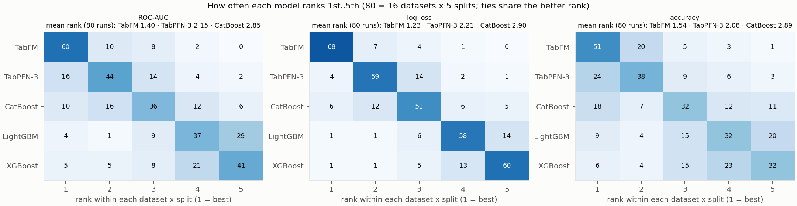

# Tabular foundation models vs gradient-boosted trees on small classification tasks, with hardware notes

Two tabular foundation models, Google's **TabFM** and Prior Labs' **TabPFN-3**,
against three gradient-boosted decision tree (GBDT) libraries, **CatBoost**,
**LightGBM** and **XGBoost**, on 16 public classification datasets of up to 5,000
rows, 5 train/test splits each, every model at its default settings (exceptions in
[docs/methods.md](docs/methods.md#settings-that-differ-from-the-library-defaults)).

The figure ranks the models on each of the 80 runs. The table below ranks each
model's per-dataset mean score instead (1 = best; ties share the better rank):

| Metric | TabFM | TabPFN-3 | CatBoost | LightGBM | XGBoost |
|---|---:|---:|---:|---:|---:|
| ROC-AUC | 1.19 | 2.19 | 3.12 | 4.25 | 4.19 |
| Log loss | 1.06 | 2.12 | 3.00 | 4.06 | 4.75 |
| Accuracy | 1.31 | 2.06 | 3.00 | 3.94 | 4.50 |

- TabFM ranks first (including ties for first) in 60 of 80 runs on ROC-AUC and 68
  on log loss.
- Between the two foundation models, the gap in per-dataset means is usually
  smaller than the variation between splits. On the same split, though, TabFM has
  the lower log loss in 72 of 80 runs (ROC-AUC: higher in 62).
- Log loss separates the models more than accuracy: on MIC, default LightGBM and
  XGBoost have log loss 1.05 and 0.63, against 0.43–0.48 for the other three
  models, at similar accuracy.
- On the same split, an A100 and an L4 give identical accuracy in 60 (TabFM) and
  61 (TabPFN-3) of 80 runs, and never differ by more than 2 test rows. TabFM is
  slow on a CPU (124–210 s per dataset on an M3 Ultra, for 4 datasets of 748–1,014
  rows), and its default bfloat16 does not run on a T4.

This is not a claim that one model is better in general: the datasets are small,
the splits of a dataset are not independent, no significance test is made, and
tuned GBDTs would likely narrow the gaps.

## More

- [RESULTS.md](RESULTS.md): head-to-head counts, per-dataset tables and figures
- [docs/methods.md](docs/methods.md): models, versions, splits, metrics, caveats,
  how to reproduce
- [docs/data.md](docs/data.md): datasets, modifications, attribution and licenses
- [docs/hardware.md](docs/hardware.md): machines, inference time, memory, T4 and
  TPU notes
- [results/results_long.csv](results/results_long.csv): every per-run result

## Next

The same comparison on larger datasets (more than 5,000 rows).

## License

Code: Apache-2.0 (see [LICENSE](LICENSE)). The model weights and datasets are not
included and stay under their own licenses (see [docs/methods.md](docs/methods.md)
and [docs/data.md](docs/data.md)).

## Acknowledgments

This work was done as part of the Google TPU Builders Program, whose Google Cloud
credits paid for all cloud compute (TPU and GPU). The author has no affiliation
with Google, Prior Labs, or the authors of the GBDT libraries.
