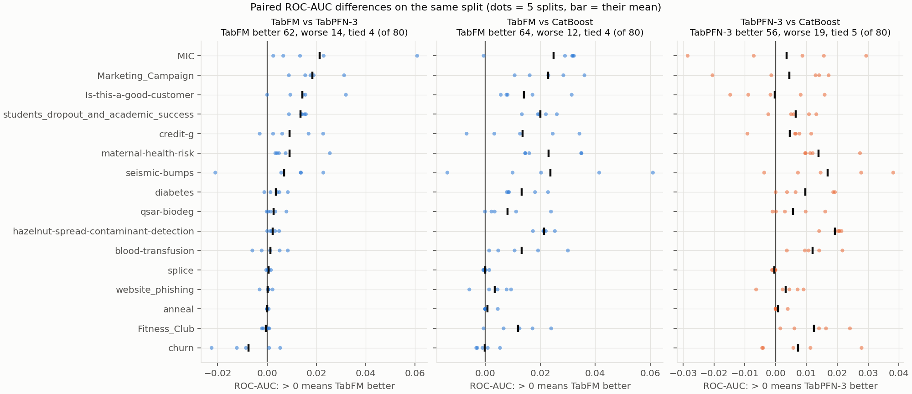
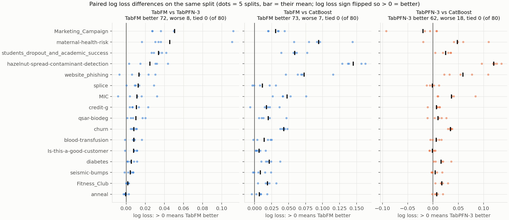
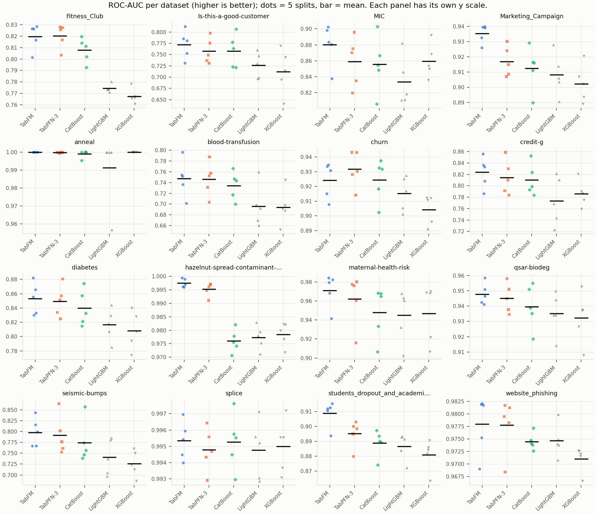
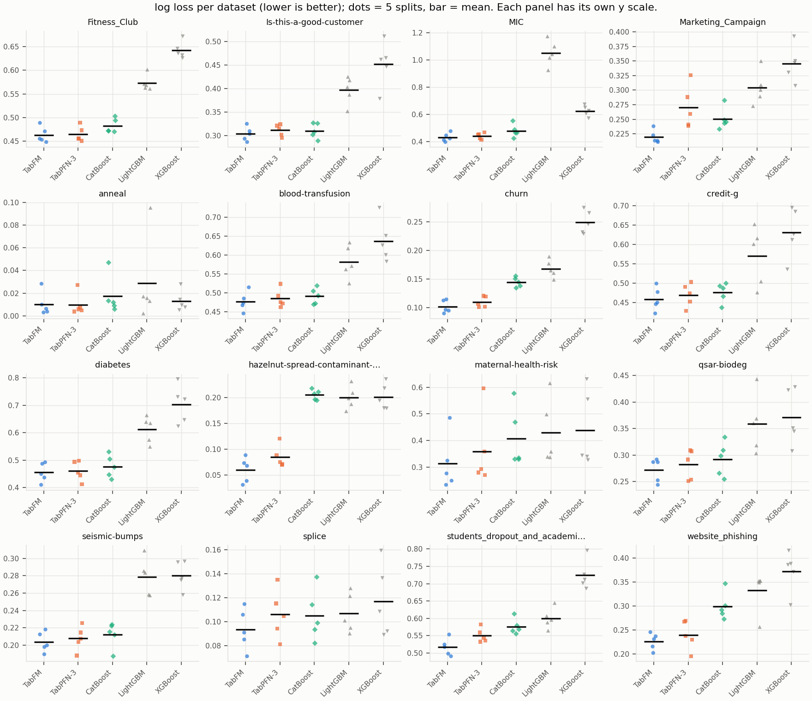

# Results

All models at default settings. TabFM and TabPFN-3 ran on an A100; CatBoost, LightGBM and XGBoost on a Mac CPU (Apple M3 Ultra). 16 datasets × 5 train/test splits (seeds 42–46) = 80 runs per model. Source: `results/results_long.csv`.

## Ranks and head-to-head

Mean rank of each model's per-dataset mean score (16 datasets; 1 = best; ties share the better rank):

| Metric | TabFM | TabPFN-3 | CatBoost | LightGBM | XGBoost |
|---|---:|---:|---:|---:|---:|
| ROC-AUC | 1.19 | 2.19 | 3.12 | 4.25 | 4.19 |
| Log loss | 1.06 | 2.12 | 3.00 | 4.06 | 4.75 |
| Accuracy | 1.31 | 2.06 | 3.00 | 3.94 | 4.50 |

Wins / losses / ties of the first-named model over the 80 runs, paired by dataset and split:

| Comparison | ROC-AUC | Log loss | Accuracy |
|---|---|---|---|
| TabFM vs TabPFN-3 | 62 / 14 / 4 | 72 / 8 / 0 | 47 / 15 / 18 |
| TabFM vs CatBoost | 64 / 12 / 4 | 73 / 7 / 0 | 59 / 14 / 7 |
| TabPFN-3 vs CatBoost | 56 / 19 / 5 | 62 / 18 / 0 | 52 / 21 / 7 |

## Per-dataset tables

Mean ± standard deviation over the 5 splits. **Bold** marks the best unrounded mean per row, so two equal displayed values can differ in bold. Datasets are sorted by size.

### ROC-AUC (higher is better)

| Dataset | TabFM | TabPFN-3 | CatBoost | LightGBM | XGBoost |
|---|---:|---:|---:|---:|---:|
| blood-transfusion | **0.748 ± 0.034** | 0.746 ± 0.031 | 0.734 ± 0.026 | 0.696 ± 0.039 | 0.694 ± 0.033 |
| diabetes | **0.853 ± 0.022** | 0.849 ± 0.022 | 0.840 ± 0.025 | 0.817 ± 0.022 | 0.808 ± 0.026 |
| anneal | **1.000 ± 0.000** | 1.000 ± 0.000 | 0.999 ± 0.002 | 0.991 ± 0.019 | **1.000 ± 0.000** |
| credit-g | **0.824 ± 0.027** | 0.815 ± 0.030 | 0.810 ± 0.028 | 0.773 ± 0.042 | 0.786 ± 0.023 |
| maternal-health-risk | **0.971 ± 0.018** | 0.962 ± 0.027 | 0.948 ± 0.028 | 0.945 ± 0.028 | 0.947 ± 0.030 |
| qsar-biodeg | **0.948 ± 0.007** | 0.945 ± 0.010 | 0.940 ± 0.014 | 0.935 ± 0.014 | 0.932 ± 0.017 |
| website_phishing | **0.978 ± 0.006** | 0.978 ± 0.005 | 0.974 ± 0.002 | 0.975 ± 0.003 | 0.971 ± 0.003 |
| Fitness_Club | 0.820 ± 0.011 | **0.820 ± 0.010** | 0.808 ± 0.011 | 0.774 ± 0.003 | 0.767 ± 0.006 |
| MIC | **0.880 ± 0.026** | 0.859 ± 0.031 | 0.855 ± 0.035 | 0.833 ± 0.031 | 0.859 ± 0.022 |
| Is-this-a-good-customer | **0.772 ± 0.031** | 0.758 ± 0.028 | 0.758 ± 0.037 | 0.726 ± 0.028 | 0.712 ± 0.049 |
| Marketing_Campaign | **0.935 ± 0.006** | 0.917 ± 0.010 | 0.912 ± 0.014 | 0.908 ± 0.014 | 0.902 ± 0.012 |
| hazelnut-spread-contaminant-detection | **0.997 ± 0.002** | 0.995 ± 0.003 | 0.976 ± 0.004 | 0.977 ± 0.004 | 0.978 ± 0.004 |
| seismic-bumps | **0.798 ± 0.033** | 0.791 ± 0.045 | 0.774 ± 0.048 | 0.741 ± 0.041 | 0.726 ± 0.030 |
| splice | **0.995 ± 0.001** | 0.995 ± 0.001 | 0.995 ± 0.002 | 0.995 ± 0.002 | 0.995 ± 0.002 |
| students_dropout_and_academic_success | **0.909 ± 0.009** | 0.895 ± 0.009 | 0.889 ± 0.009 | 0.887 ± 0.009 | 0.881 ± 0.010 |
| churn | 0.924 ± 0.012 | **0.932 ± 0.012** | 0.924 ± 0.014 | 0.915 ± 0.012 | 0.904 ± 0.010 |

### Log loss (lower is better)

| Dataset | TabFM | TabPFN-3 | CatBoost | LightGBM | XGBoost |
|---|---:|---:|---:|---:|---:|
| blood-transfusion | **0.477 ± 0.025** | 0.485 ± 0.024 | 0.491 ± 0.021 | 0.582 ± 0.044 | 0.637 ± 0.056 |
| diabetes | **0.455 ± 0.035** | 0.461 ± 0.036 | 0.477 ± 0.041 | 0.612 ± 0.048 | 0.703 ± 0.069 |
| anneal | 0.010 ± 0.010 | **0.010 ± 0.010** | 0.017 ± 0.017 | 0.029 ± 0.038 | 0.013 ± 0.009 |
| credit-g | **0.459 ± 0.030** | 0.469 ± 0.030 | 0.476 ± 0.025 | 0.570 ± 0.076 | 0.630 ± 0.064 |
| maternal-health-risk | **0.314 ± 0.102** | 0.360 ± 0.137 | 0.408 ± 0.112 | 0.429 ± 0.123 | 0.439 ± 0.143 |
| qsar-biodeg | **0.272 ± 0.022** | 0.283 ± 0.028 | 0.292 ± 0.032 | 0.359 ± 0.055 | 0.371 ± 0.053 |
| website_phishing | **0.226 ± 0.017** | 0.240 ± 0.030 | 0.299 ± 0.028 | 0.332 ± 0.042 | 0.372 ± 0.043 |
| Fitness_Club | **0.463 ± 0.017** | 0.465 ± 0.016 | 0.482 ± 0.015 | 0.573 ± 0.016 | 0.642 ± 0.018 |
| MIC | **0.431 ± 0.031** | 0.442 ± 0.023 | 0.478 ± 0.047 | 1.052 ± 0.093 | 0.626 ± 0.039 |
| Is-this-a-good-customer | **0.303 ± 0.015** | 0.311 ± 0.012 | 0.310 ± 0.016 | 0.397 ± 0.029 | 0.452 ± 0.048 |
| Marketing_Campaign | **0.220 ± 0.011** | 0.270 ± 0.037 | 0.251 ± 0.019 | 0.304 ± 0.029 | 0.345 ± 0.031 |
| hazelnut-spread-contaminant-detection | **0.060 ± 0.024** | 0.085 ± 0.021 | 0.205 ± 0.010 | 0.200 ± 0.022 | 0.201 ± 0.025 |
| seismic-bumps | **0.203 ± 0.012** | 0.208 ± 0.014 | 0.212 ± 0.015 | 0.279 ± 0.022 | 0.280 ± 0.016 |
| splice | **0.093 ± 0.017** | 0.106 ± 0.020 | 0.105 ± 0.021 | 0.107 ± 0.017 | 0.117 ± 0.030 |
| students_dropout_and_academic_success | **0.516 ± 0.025** | 0.550 ± 0.020 | 0.576 ± 0.022 | 0.600 ± 0.029 | 0.724 ± 0.043 |
| churn | **0.101 ± 0.011** | 0.110 ± 0.010 | 0.144 ± 0.009 | 0.168 ± 0.016 | 0.249 ± 0.020 |

### Accuracy (higher is better)

| Dataset | TabFM | TabPFN-3 | CatBoost | LightGBM | XGBoost |
|---|---:|---:|---:|---:|---:|
| blood-transfusion | **0.791 ± 0.008** | 0.781 ± 0.013 | 0.789 ± 0.011 | 0.737 ± 0.019 | 0.732 ± 0.021 |
| diabetes | 0.770 ± 0.031 | 0.764 ± 0.032 | **0.771 ± 0.028** | 0.748 ± 0.022 | 0.752 ± 0.020 |
| anneal | 0.998 ± 0.003 | **0.999 ± 0.002** | 0.997 ± 0.005 | 0.994 ± 0.004 | 0.996 ± 0.005 |
| credit-g | 0.776 ± 0.029 | 0.777 ± 0.026 | **0.778 ± 0.020** | 0.760 ± 0.027 | 0.747 ± 0.033 |
| maternal-health-risk | **0.874 ± 0.028** | 0.862 ± 0.035 | 0.839 ± 0.030 | 0.836 ± 0.025 | 0.843 ± 0.031 |
| qsar-biodeg | **0.896 ± 0.018** | 0.894 ± 0.015 | 0.883 ± 0.020 | 0.877 ± 0.028 | 0.871 ± 0.018 |
| website_phishing | **0.905 ± 0.014** | 0.903 ± 0.014 | 0.880 ± 0.010 | 0.883 ± 0.007 | 0.881 ± 0.010 |
| Fitness_Club | 0.766 ± 0.017 | **0.768 ± 0.013** | 0.765 ± 0.005 | 0.749 ± 0.014 | 0.731 ± 0.010 |
| MIC | **0.889 ± 0.004** | 0.888 ± 0.003 | 0.889 ± 0.005 | 0.882 ± 0.004 | 0.887 ± 0.005 |
| Is-this-a-good-customer | **0.888 ± 0.004** | 0.887 ± 0.000 | 0.886 ± 0.005 | 0.877 ± 0.005 | 0.874 ± 0.008 |
| Marketing_Campaign | **0.903 ± 0.011** | 0.900 ± 0.012 | 0.890 ± 0.006 | 0.888 ± 0.013 | 0.879 ± 0.009 |
| hazelnut-spread-contaminant-detection | **0.980 ± 0.009** | 0.966 ± 0.007 | 0.921 ± 0.007 | 0.926 ± 0.007 | 0.922 ± 0.015 |
| seismic-bumps | **0.934 ± 0.000** | **0.934 ± 0.000** | **0.934 ± 0.004** | 0.930 ± 0.004 | 0.928 ± 0.006 |
| splice | **0.973 ± 0.003** | 0.969 ± 0.007 | 0.965 ± 0.006 | 0.970 ± 0.008 | 0.969 ± 0.008 |
| students_dropout_and_academic_success | **0.794 ± 0.012** | 0.779 ± 0.007 | 0.773 ± 0.008 | 0.775 ± 0.011 | 0.767 ± 0.013 |
| churn | **0.978 ± 0.003** | 0.975 ± 0.002 | 0.961 ± 0.006 | 0.957 ± 0.006 | 0.940 ± 0.005 |

