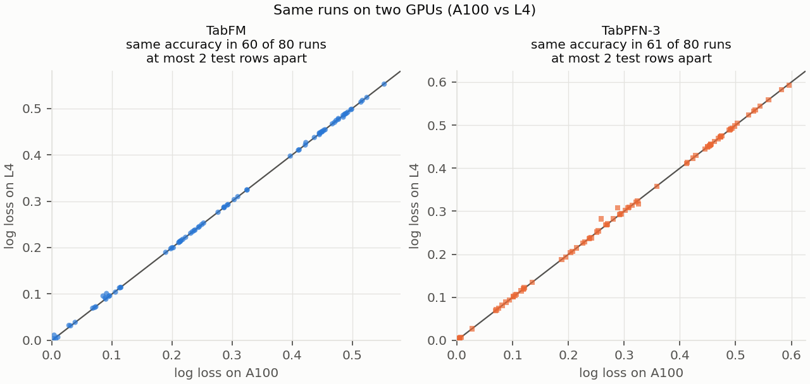

# Hardware notes

These numbers describe this setup, not the models' intrinsic speed: the two models
use different frameworks, and each call includes preprocessing on the host.

| Hardware | Machine |
|---|---|
| TPU v6e | Cloud TPU v6e, 1 chip (`ct6e-standard-1t`), July and October 2026 |
| A100 | `a2-highgpu-1g`, NVIDIA A100 40 GB, Deep Learning VM `common-cu129-ubuntu-2204-nvidia-580` |
| L4 | `g2-standard-4`, NVIDIA L4 24 GB, same image family |
| T4 | `n1-standard-4`, NVIDIA T4 16 GB, same image family |
| Mac | Apple M3 Ultra (CPU, and the GPU through PyTorch MPS) |

**Inference time** (`predict_seconds`: the second of two identical `predict_proba`
calls; the first, which includes compilation for TabFM, is discarded. Each call
includes the library's preprocessing on the host):

| | TabFM | TabPFN-3 |
|---|---|---|
| A100, 16 datasets | median 7.2 s, up to 43 s (churn, 5,000 rows) | median 0.7 s, up to 1.8 s |
| L4, 16 datasets | median 13.8 s, up to 54 s | median 0.7 s, up to 2.1 s |
| TPU v6e, 4 datasets of 748–1,014 rows | 5.7–6.0 s (July), 5.6–5.9 s (October) | — |
| Mac CPU, same 4 datasets | 124–210 s | 1.6–2.1 s |
| Mac MPS, same 4 datasets | — | 0.45–0.51 s |

The TPU and Mac rows, and the T4 runs below, are one split (seed 42) of
blood-transfusion, diabetes, credit-g and maternal-health-risk.

**Memory.** TabFM's JAX peak on the A100 and L4 was 12.6 GiB at most, including
the 5,000-row dataset, so it fits within the 16.5 GiB that JAX makes available on
an L4 by default. TabPFN-3's peak allocated CUDA memory was 1.1 GiB
(1.8 GiB reserved by PyTorch). On the TPU v6e, TabFM's peak was 12.3 GiB of the
31.2 GiB available. The two counters differ: TabFM's `peak_bytes_in_use` is a
process-wide peak, while TabPFN-3's CUDA peak is reset per dataset and split.
`nvidia-smi` memory says nothing about TabFM's use, because JAX preallocates it.

**TabFM on a T4.** The default bfloat16 does not run: with JAX's default memory
preallocation the weights do not fit, and with `XLA_PYTHON_CLIENT_MEM_FRACTION=0.95`
every dataset fails with `UNIMPLEMENTED: ALG_DOT_BF16_BF16_F32` (no bf16 matmul on
the T4). It runs with `--dtype float32`, 4.3–5.0× slower than bfloat16 on an L4 (the
September L4 run of the same 4 datasets). Compared with that run, its accuracy is lower on 3 of 4 datasets (16
fewer correct of 150 test rows on blood-transfusion) and higher on diabetes (1 row).

**TabFM on a TPU.** `tabfm[jax]` on its own installs CPU-only jax; install it in
the same step as `jax[tpu]`, or TabFM quietly runs on the CPU. `tabfm_bench.py`
checks the backend and stops if it is not the one requested. The October TPU run
gave the same accuracy as the July one on all 4 datasets, and the same as the A100
on 3 of them (1 test row fewer on credit-g).

**Same model, different hardware.**

